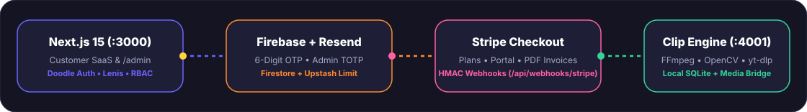

<div align="center">
  
  <br />
  <br />
  <a href="https://nextjs.org/"></a>
  <a href="https://stripe.com/"></a>
  <a href="https://firebase.google.com/"></a>
  <a href="https://resend.com/"></a>
  <a href="./LICENSE"></a>
</div>

<br />

**Clipper Studio** is a **local-first AI live & VOD clipping SaaS** wrapped in a playful **Next.js 15 + shadcn/ui** dual-surface web app (`:3000`), backed by a zero-cloud-cost local **FFmpeg / OpenCV / yt-dlp** engine (`:4001`), **Firebase + Resend OTP** auth, **Stripe** billing, and a rich **Python TUI**.

<div align="center">
  
</div>

---

## ✨ What’s Inside

| Surface | Highlights |
|:---|:---|
| 🎨 **Doodle Auth & 2FA** | Animated cursor-tracking SVG doodles (`/login`, `/signup`, `/verify-otp`), Google + Email/Password, **Resend 6-digit OTP**, Admin TOTP 2FA |
| 🎬 **Customer SaaS (`/(app)/*`)** | Live capture + SSE chat spikes, VOD Studio, BlazeFace split-facecam, 5★ ratings, chapters, comments, password share links, A/B titles, PDF invoices |
| 🛡️ **Zero-Trust `/admin`** | RBAC (`customer` → `support` → `admin` → `superadmin`), virtualized users table, Stripe orders/refunds, SLA support inbox, flags, immutable audit logs |
| 💻 **Engine & TUI (`:4001`)** | SQLite library, Streamlink capture, OpenCV webcam crop, `-14 LUFS` audio normalization, Discord/Telegram alerts (`:4003`), `clipper_tui.py` |

---

## 🚀 Quick Start

### 1. Prerequisites
Install **Node.js 22+**, **pnpm 12+**, **Python 3.10+**, `ffmpeg`, `ffprobe`, `yt-dlp`, and `streamlink`:
```powershell
# Windows (Winget)
winget install Gyan.FFmpeg Streamlink.Streamlink yt-dlp.yt-dlp --source winget
```

### 2. Install & Initialize Environment
```bash
pnpm install --allow-build esbuild --allow-build nx
pip install -r requirements.txt
cp .env.example .env.local   # PowerShell: Copy-Item .env.example .env.local
```

Generate required 32-byte secrets for `.env.local`:
```bash
node -e "const c=require('crypto'); for (const k of ['OTP_HMAC_SECRET','ADMIN_TOTP_ENCRYPTION_KEY','INTERNAL_BRIDGE_SECRET']) console.log(`${k}=\"${c.randomBytes(32).toString('hex')}\"`);"
```

### 3. Run Full Stack (`:3000`, `:4001`, `:4003`)
```bash
pnpm dev      # Next.js SaaS (:3000) + Clipper Engine (:4001) + Notifier (:4003)
pnpm tui      # Optional Python Terminal UI
```
Open **`http://localhost:3000/login`** (or **`http://127.0.0.1:4001`** for legacy engine controls).

---

## ⚙️ Service Setup Guides (Click to Expand)

<details>
<summary><strong>🔥 Firebase Auth, Firestore Rules & Superadmin Bootstrap</strong></summary>

1. In [Firebase Console](https://console.firebase.google.com/), enable **Authentication → Email/Password & Google** (add `localhost` to Authorized Domains).
2. Add Web App keys (`NEXT_PUBLIC_FIREBASE_*`) and Service Account keys (`FIREBASE_PROJECT_ID`, `FIREBASE_CLIENT_EMAIL`, `FIREBASE_PRIVATE_KEY`) to `.env.local`.
3. Set `SUPERADMIN_BOOTSTRAP_EMAIL="you@domain.com"` for automatic first-login `superadmin` claims.
4. Deploy rules & indexes:
   ```bash
   cd apps/web && firebase deploy --only firestore:rules,firestore:indexes
   ```

</details>

<details>
<summary><strong>💳 Stripe Checkout, Customer Portal & Local Webhooks</strong></summary>

1. In [Stripe Dashboard](https://dashboard.stripe.com/) (**Test Mode**), copy **Publishable key** (`pk_test_...` → `NEXT_PUBLIC_STRIPE_PUBLISHABLE_KEY`) and **Secret key** (`sk_test_...` → `STRIPE_SECRET_KEY`).
2. Dynamic checkout prices generate automatically from your Pro/Ultra plan config — or optionally create recurring Prices in Stripe (`STRIPE_PRO_PRICE_ID` / `STRIPE_ULTRA_PRICE_ID`) or Payment Links (`STRIPE_PRO_PAYMENT_LINK`).
3. Activate your Portal under **Settings → Billing → Customer portal** (`STRIPE_PORTAL_URL`).
4. Forward signed webhooks locally with [Stripe CLI](https://stripe.com/docs/stripe-cli):
   ```bash
   stripe login
   stripe listen --forward-to http://127.0.0.1:3000/api/webhooks/stripe
   ```
   Paste the printed `whsec_...` secret into `STRIPE_WEBHOOK_SECRET` in `.env.local`.

</details>

<details>
<summary><strong>✉️ Resend OTP & Upstash Redis (Optional for Dev)</strong></summary>

- **Resend**: Set `RESEND_API_KEY` and `RESEND_FROM_EMAIL`. For local offline testing without Resend (`NODE_ENV !== "production"`), set `DEV_OTP_ECHO="true"` to preview codes on `/verify-otp`.
- **Upstash**: Set `UPSTASH_REDIS_REST_URL` + `UPSTASH_REDIS_REST_TOKEN` for distributed API rate limiting (auto-falls back to in-memory sliding windows locally).

</details>

<details>
<summary><strong>🔄 Safe Tool Updates & Verification</strong></summary>

```powershell
.\update.ps1 -Check   # Windows: check upstream commits without modifying files
.\update.ps1          # Backup .env.local & SQLite -> pull -> install -> build
```
```bash
./update.sh           # macOS / Linux updater
```

Run tests & build checks anytime:
```bash
pnpm test
pnpm nx run-many -t build typecheck
```

</details>

---

## 🔒 Security

Zero-trust RBAC, timing-safe `HMAC-SHA256` OTPs, `AES-256-GCM` Admin TOTP, loopback `INTERNAL_BRIDGE_SECRET` isolation, OWASP CSV formula escaping, and SSRF IPv4/IPv6 blocking are documented in [`SECURITY.md`](SECURITY.md).
